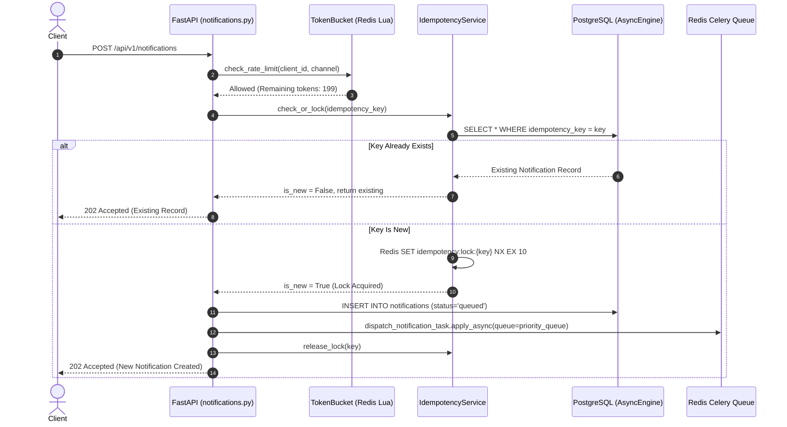
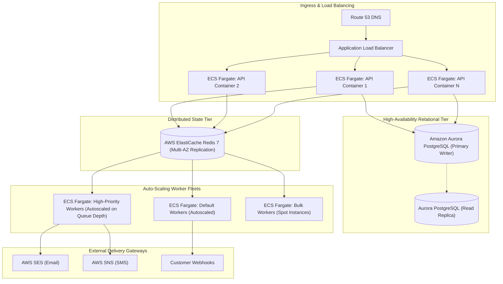

# 🎯 Distributed Notification Platform — Comprehensive Interview Guide & Technical Deep Dive

**Mastery Guide for Senior Backend Engineers, System Designers, and Technical Interviewees**  
*Covers Python 3.12, FastAPI, Celery, Redis Lua, PostgreSQL, Distributed Systems, and Architecture Defense*

---

## Table of Contents
1. [Section A: Project Explanations (30s, 2-Min, 5-Min Pitches)](#section-a-project-explanations)
2. [Section B: Architectural & Code Walkthrough](#section-b-architectural--code-walkthrough)
3. [Section C: Core Technical Concepts & Design Patterns](#section-c-core-technical-concepts--design-patterns)
4. [Section D: 25 High-Frequency Technical Interview Questions & Answers](#section-d-25-high-frequency-technical-interview-questions--answers)
5. [Section E: Advanced System Design, Bottlenecks & Production Scaling](#section-e-advanced-system-design-bottlenecks--production-scaling)
6. [Section F: Practical Behavioral & Technical Interview Scenarios](#section-f-practical-behavioral--technical-interview-scenarios)

---

## Section A: Project Explanations

### 1. The 30-Second Elevator Pitch
> *"I designed and engineered a high-throughput, distributed notification engine in Python using FastAPI, Celery, Redis, and PostgreSQL. It reliably dispatches multi-channel messages across Email, SMS, and Webhooks at over 10,000 notifications per minute. The system guarantees zero duplicate sends through dual-tier Redis and database idempotency, prevents downstream gateway throttling using an atomic Redis Lua token-bucket rate limiter, and ensures zero message loss during third-party outages with priority queues, exponential jitter retries, and an automated Dead-Letter Queue redrive system."*

---

### 2. The 2-Minute Technical Project Explanation
> *"In microservice architectures, sending notifications directly within HTTP request cycles leads to high latency, cascading failures, and duplicate messages whenever upstream providers like AWS SES or Twilio experience jitter.*
>
> *To solve this, I developed the Distributed Notification Platform using an asynchronous, event-driven architecture:*
> 1. *On the ingestion side, an asynchronous FastAPI layer validates incoming requests in under 10 milliseconds. Before accepting a notification, it executes an atomic Lua script in Redis implementing a Token-Bucket algorithm to enforce strict 10,000+ req/min throughput limits without concurrency race conditions.*
> 2. *To guarantee strict idempotency, it checks PostgreSQL and acquires a temporary distributed lock in Redis. If a client retries a payment receipt or OTP, the platform returns the existing notification without double-dispatching.*
> 3. *For queuing and delivery, the API writes the initial record to PostgreSQL and publishes task IDs into Redis priority queues—`high`, `default`, and `low`. Dedicated Celery worker pools process tasks asynchronously. High-priority security alerts and OTPs are never blocked behind bulk marketing emails.*
> 4. *For resilience, delivery providers utilize an adapter pattern. When transient errors or 5xx gateway responses occur, workers execute exponential backoff retries with randomized jitter to prevent thundering herd problems. If a message exhausts all five retries, it is automatically quarantined into a Dead-Letter Queue (DLQ). Operations teams can monitor health via Prometheus metrics and use our one-click DLQ redrive API to recover stranded messages once upstream services recover.*
>
> *This decoupled design ensures high availability, sub-second delivery for critical alerts, and complete audit traceability."*

---

### 3. The 5-Minute Senior System Design Explanation
> *"When building an enterprise notification platform, the primary engineering challenge is balancing high ingestion throughput with resilience against unreliable external third-party APIs.*
>
> *Let's break down the architecture into its four core tiers:*
>
> #### 1. Ingestion & Boundary Tier (FastAPI & AsyncPG)
> *The ingestion layer is built on FastAPI and ASGI. We use a **Dual Database Engine pattern**: FastAPI uses `asyncpg` for non-blocking asynchronous I/O, allowing our API pods to hold open thousands of concurrent connections with minimal memory footprint.*
> *Incoming payloads undergo Pydantic v2 validation. If dynamic templating is requested, our Jinja2 sandbox compiles the subject and body while escaping HTML to defend against injection attacks.*
>
> #### 2. Concurrency & Rate Control (Atomic Redis Lua Scripts)
> *Rate limiting at scale often suffers from race conditions if implemented with standard Redis GET and SET operations. To achieve true atomicity, I implemented a Token-Bucket rate limiter inside an embedded Redis Lua script. The script calculates token refill mathematically based on elapsed time ($\Delta t \times r$) and decrements tokens atomically in a single Redis roundtrip. This guarantees exact enforcement of our 166.67 tokens/sec (~10,000/min) capacity even across dozens of concurrent API containers.*
> *Similarly, idempotency utilizes a two-tier check: first a fast relational query against our indexed `idempotency_key`, followed by an atomic Redis `SET NX EX` mutex with a 10-second TTL to catch simultaneous in-flight duplicates.*
>
> #### 3. Task Queuing & Priority Separation (Celery & Kombu)
> *Once persisted to PostgreSQL in a `QUEUED` state, the task is dispatched to Redis using Celery. We configured direct Kombu exchanges with priority queues: `high_priority` (priority 9), `default_priority` (priority 5), and `low_priority` (priority 1).*
> *We explicitly tune our worker pool with `worker_prefetch_multiplier = 1` and `task_acks_late = True`. Prefetching only one task ensures that high-priority workers are never starved holding onto bulk low-priority tasks. Late acknowledgment ensures that if a worker container is terminated mid-execution by the OS or an OOM killer, the task is automatically returned to the broker and picked up by another worker.*
>
> #### 4. Delivery Layer, Fault Tolerance & The DLQ Pipeline
> *Workers execute delivery via channel-specific adapters (AWS SES for email, AWS SNS for SMS, and HTTP clients for webhooks). For webhooks, we sign payloads using HMAC-SHA256 signatures with timestamp headers, and receivers verify them using `hmac.compare_digest` to prevent timing attacks.*
> *When an upstream provider fails, we classify errors into retryable (e.g. HTTP 429, 502, 503, timeouts) versus non-retryable (e.g. 400 Bad Request, invalid phone numbers, email hard bounces). Retryable errors trigger exponential backoff with full jitter to avoid synchronous retry spikes.*
> *If an alert fails 5 consecutive times, it transitions to `status = 'dlq'` and routes to our Dead-Letter Queue. We expose dedicated management endpoints (`/api/v1/dlq/stats` and `/api/v1/dlq/redrive`) that allow bulk re-enqueueing of dead-lettered messages back to the high-priority queue once upstream providers recover.*
>
> #### 5. Observability
> *We instrumented custom Prometheus metrics: tracking end-to-end delivery latencies via Histograms, monitoring queue depths via Gauges, and tracking DLQ pushes and idempotency cache hits via Counters. We also built an interactive web dashboard providing real-time visibility into system health, throughput, and worker states."*

---

### 4. Technical Contributions & Ownership
- **Architecture**: Designed the decoupled asynchronous architecture separating HTTP ingestion from worker execution.
- **Concurrency & Scalability**: Wrote atomic Redis Lua scripts for the Token-Bucket rate limiter and distributed mutex locking.
- **Database Engineering**: Architected the relational schema in PostgreSQL 16 with composite indexing (`ix_notifications_status_priority` and `ix_notifications_scheduled`) and managed dual `asyncpg`/`psycopg2` engines.
- **Reliability Engineering**: Formulated the exponential backoff with jitter retry strategy, automated DLQ state transitions, and asynchronous bulk redrive task.
- **Security**: Built HMAC-SHA256 cryptographic signing and timing-safe verification for webhooks.

---

## Section B: Architectural & Code Walkthrough

### 1. Ingestion & In-Flight Lock Flow



---

### 2. Code Breakdown: Token Bucket Lua Script
**File**: [`app/core/redis.py:81-115`](file:///d:/Backend-Development/fastAPI%20Projects/Distributed-Notification-Platform/app/core/redis.py#L81-L115)

```lua
local tokens_key = KEYS[1]
local timestamp_key = KEYS[2]

local capacity = tonumber(ARGV[1])
local refill_rate = tonumber(ARGV[2])
local requested = tonumber(ARGV[3])
local now = tonumber(ARGV[4])
local ttl = math.ceil(capacity / refill_rate) * 2

local current_tokens = tonumber(redis.call('get', tokens_key))
local last_updated = tonumber(redis.call('get', timestamp_key))

if not current_tokens then
    current_tokens = capacity
    last_updated = now
else
    local elapsed = math.max(0, now - last_updated)
    current_tokens = math.min(capacity, current_tokens + (elapsed * refill_rate))
    last_updated = now
end

if current_tokens >= requested then
    current_tokens = current_tokens - requested
    redis.call('setex', tokens_key, ttl, current_tokens)
    redis.call('setex', timestamp_key, ttl, last_updated)
    return {1, current_tokens}
else
    local missing = requested - current_tokens
    local retry_after = missing / refill_rate
    redis.call('setex', tokens_key, ttl, current_tokens)
    redis.call('setex', timestamp_key, ttl, last_updated)
    return {0, retry_after}
end
```

#### Why This Code Exists & How to Explain It:
- **Beginner-Friendly Explanation**: Imagine a bucket that holds up to 200 water drops (`capacity`). Every second, a tap drips 166.67 drops into the bucket (`refill_rate`). When a user makes a request, they need 1 drop. If the bucket has enough water, we subtract 1 drop and say "Yes, allowed". If it's empty, we calculate how many seconds until enough drops refill and tell the user "No, wait $X$ seconds".
- **Senior Technical Explanation**: *"In distributed environments, a naive GET $\to$ calculate $\to$ SET creates a critical race condition under high concurrency. Two API instances could read 1 token remaining simultaneously and both decrement it, causing rate limit breaches. By bundling the replenishment calculation and consumption into a single Redis Lua script, the entire check runs atomically within Redis's single-threaded execution model in microseconds."*

---

### 3. Code Breakdown: Celery Worker Task & Retry with Jitter
**File**: [`app/tasks/notification_tasks.py:105-158`](file:///d:/Backend-Development/fastAPI%20Projects/Distributed-Notification-Platform/app/tasks/notification_tasks.py#L105-L158)

```python
# Delivery Failed - Check Retry Eligibility
notification.retry_count += 1
notification.error_details = result.error_message

if result.retryable and notification.retry_count < notification.max_retries:
    # Exponential Backoff with Jitter: base * (factor ^ retry) + random_jitter
    base_delay = settings.RETRY_BASE_DELAY_SECONDS
    factor = settings.RETRY_EXPONENTIAL_FACTOR
    jitter = random.uniform(0.1, 1.0)
    calculated_delay = min(
        base_delay * (factor ** notification.retry_count) + jitter,
        settings.RETRY_MAX_DELAY_SECONDS,
    )

    notification.status = NotificationStatus.QUEUED.value
    db.commit()

    # Retry task asynchronously via Celery
    raise self.retry(exc=Exception(result.error_message), countdown=int(calculated_delay))
else:
    # Max retries exceeded or non-retryable error -> Push to Dead-Letter Queue (DLQ)
    notification.status = NotificationStatus.DLQ.value
    notification.failed_at = datetime.now(timezone.utc)
    db.commit()

    DLQ_PUSHES_TOTAL.labels(
        channel=notification.channel,
        reason="max_retries_exceeded" if result.retryable else "non_retryable_error",
    ).inc()
```

#### Why This Code Exists & How to Explain It:
- **Beginner-Friendly Explanation**: If sending an email fails because the server had a brief hiccup, we don't give up immediately. We wait a little bit (exponentially longer each time: 4s, 8s, 16s...) and add a tiny random fraction of a second (`jitter`). If it still fails after 5 tries, we move it to a "Dead-Letter Queue" so we don't crash our system or retry forever.
- **Senior Technical Explanation**: *"Standard exponential backoff without jitter causes what is known as the **Thundering Herd Problem** or **Retry Storm**. If 1,000 requests fail simultaneously during an upstream network glitch, pure exponential backoff means all 1,000 requests will wake up and retry at the exact same second, knocking the upstream service down again. Full jitter introduces entropy, desynchronizing the retry wave and smoothing the traffic curve."*

---

### 4. Code Breakdown: Cryptographic Webhook Signing
**File**: [`app/providers/webhook_provider.py:24-32, 59-68`](file:///d:/Backend-Development/fastAPI%20Projects/Distributed-Notification-Platform/app/providers/webhook_provider.py#L24-L32)

```python
def _generate_signature(self, payload_bytes: bytes, timestamp: str) -> str:
    """Compute HMAC-SHA256 signature: hmac(secret, timestamp + '.' + body)."""
    sign_payload = f"{timestamp}.".encode("utf-8") + payload_bytes
    signature = hmac.new(
        self.secret_key.encode("utf-8"),
        sign_payload,
        hashlib.sha256,
    ).hexdigest()
    return signature
```

#### Why This Code Exists & How to Explain It:
- **Beginner-Friendly Explanation**: Anyone can send an HTTP POST to a customer's webhook endpoint pretending to be our platform. To prove it's really from us, we stamp the message with a digital seal (`HMAC-SHA256`) that can only be made using a shared secret key and the current timestamp.
- **Senior Technical Explanation**: *"Including the timestamp in the HMAC signed payload prevents **Replay Attacks**. If an attacker intercepts the payload, they cannot resend it 10 minutes later because the receiver will reject stale timestamps. Furthermore, during verification, we enforce `hmac.compare_digest` which executes in constant time, neutralizing timing side-channel attacks."*

---

## Section C: Core Technical Concepts & Design Patterns

### 1. The Dual Database Engine Pattern
- **Concept**: Using two distinct SQLAlchemy database engines in the same codebase:
  1. `create_async_engine(DATABASE_URL)` (`postgresql+asyncpg://`) $\to$ Used exclusively by FastAPI route handlers.
  2. `create_engine(DATABASE_SYNC_URL)` (`postgresql+psycopg2://`) $\to$ Used exclusively by Celery background worker tasks.
- **Why this approach?**: FastAPI is asynchronous (ASGI). Using synchronous DB drivers inside async endpoints blocks the event loop and destroys concurrency. Conversely, Celery worker processes execute in synchronous multiprocessing pools (`prefork`). Running `asyncio.run()` inside prefork workers can cause severe event-loop collision and connection pool corruption. Separating the engines provides optimal concurrency for the web tier and battle-tested stability for the worker fleet.

### 2. Token Bucket vs. Leaky Bucket vs. Sliding Window
- **Leaky Bucket**: Smooths out traffic into a constant, fixed output rate. Disadvantage: Cannot accommodate legitimate short bursts of traffic (e.g. 50 OTP requests during a flash sale).
- **Sliding Window Log**: Stores a Redis sorted set (`ZADD`) of timestamps for every single request. Disadvantage: Massive memory consumption ($O(N)$ with request volume); at 10,000 req/min, Redis memory balloons quickly.
- **Token Bucket (Our Choice)**: Stores only two small numbers in Redis (`tokens` float and `timestamp` float). Memory footprint is $O(1)$ constant ($\approx 64$ bytes per key). Permitted burst up to capacity ($C=200$) while maintaining a strict continuous average refill rate ($r=166.67/\text{s}$).

### 3. Idempotency Strategies: Distributed Locks vs. Two-Phase Commit
- We implement **At-Least-Once Delivery with Deduplicated Processing**:
  - A distributed Redis mutex (`SET lock_key in_progress NX EX 10`) guarantees that concurrent requests within a 10-second window are blocked with `409 Conflict`.
  - The database unique constraint `idempotency_key` guarantees storage-level uniqueness. If the exact same request arrives hours later, the relational index hit returns the existing notification without sending duplicate emails.

### 4. Celery Worker Concurrency & Late Acknowledgment
- **`task_acks_late = True`**: By default, Celery acknowledges a task *before* executing it. If the worker machine crashes or the container is terminated during delivery, the message is permanently lost. With `task_acks_late`, Celery only sends the `ACK` to Redis *after* the task finishes. If the worker crashes mid-task, Redis releases the task to another worker.
- **`worker_prefetch_multiplier = 1`**: Prevents a single worker from hoarding 100 tasks in its internal buffer. Every worker pulls exactly 1 task at a time, ensuring that high-priority tasks are picked up immediately by any available worker.

---

## Section D: 25 High-Frequency Technical Interview Questions & Answers

### 1. Architecture & Design
#### Q1: "Walk me through the high-level architecture of your notification engine."
**Answer**:
> *"The platform is divided into three distinct decoupled layers:
> First, an Ingestion Layer built on FastAPI and AsyncPG that handles API key authentication, atomic Token-Bucket rate limiting via Redis Lua scripts, and dual-tier idempotency checks, accepting requests in under 10ms.
> Second, a Queuing & Orchestration Layer powered by Redis and Celery, featuring priority queues (`high`, `default`, `low`) and an automated Dead-Letter Queue (DLQ).
> Third, a Worker & Provider Adapter Layer where dedicated Celery worker pools execute delivery across AWS SES, AWS SNS, and HMAC-signed Webhooks, complete with exponential backoff retries and Prometheus latency tracing."*

#### Q2: "Why did you choose Redis as both the message broker and cache instead of RabbitMQ or Kafka?"
**Answer**:
> *"For this system's scale and operational profile (~10,000 notifications/min), Redis provided the optimal balance of throughput, simplicity, and unified infrastructure:
> 1. Redis serves as our high-speed cache for distributed locks (`SET NX EX`) and atomic Lua-based token buckets. Using Redis as the Celery broker eliminated the operational complexity of managing a separate broker cluster.
> 2. Kafka is designed for high-throughput append-only distributed event streaming where consumers track their own offsets and replay historical partitions. It does not provide native task-level priority queues or dead-letter re-routing without substantial custom infrastructure.
> 3. While RabbitMQ is an excellent AMQP broker with native priority queues, Redis provided lower operational overhead and microsecond-level latency for our dual caching and queuing requirements."*

#### Q3: "How does your priority queue architecture ensure high-priority alerts are delivered on time?"
**Answer**:
> *"We configure Kombu direct exchanges with separate priority queues: `high_priority` (priority 9), `default_priority` (5), and `low_priority` (1). In our Docker orchestration, we run dedicated worker pools: `notif_worker_high` only consumes from `high_priority`. Even if there is a backlog of 50,000 low-priority marketing emails in `low_priority`, the high-priority worker fleet is completely isolated and continues dispatching OTPs and security alerts with zero queuing delay."*

---

### 2. Business Logic & Concurrency
#### Q4: "How does your token-bucket rate limiter work under the hood?"
**Answer**:
> *"It runs an atomic Lua script directly in Redis. The script takes the bucket's capacity (200 tokens) and refill rate (166.67 tokens/sec). On each call, it calculates how many tokens should have replenished based on the delta between the current timestamp and the last updated timestamp: $\min(\text{capacity}, \text{current} + \Delta t \times r)$. If there are sufficient tokens, it decrements and allows the request. If not, it calculates the exact `retry_after` duration and returns 0. Because Redis executes Lua scripts atomically, concurrent API requests never suffer from race conditions."*

#### Q5: "What happens when two identical requests arrive at the exact same millisecond with the same idempotency key?"
**Answer**:
> *"Both requests pass schema validation and enter `idempotency_service.check_or_lock()`.
> Both query PostgreSQL for an existing record; neither finds one.
> Both attempt to execute `redis.set(f'idempotency:lock:{key}', 'in_progress', nx=True, ex=10)`.
> Because `nx=True` (set if not exists) is atomic in Redis, exactly one request successfully acquires the lock and proceeds to insert the notification. The second request fails to acquire the lock and immediately raises an `IdempotencyConflictException`, which our global exception handler translates into an `HTTP 409 Conflict`."*

#### Q6: "Why is exponential backoff with jitter superior to standard fixed retries?"
**Answer**:
> *"If an upstream provider like AWS SES has a 2-second network blip, 1,000 notifications might fail at once. With fixed retries (e.g. retry every 5s), all 1,000 workers will retry at second 5, second 10, and second 15, creating repeated traffic spikes that overwhelm the recovering gateway (the Thundering Herd Problem).
> Exponential backoff increases the delay exponentially ($2 \times 2^{\text{attempt}}$), while random jitter ($+ \text{Uniform}(0.1, 1.0)$) scatters the retries across a continuous time window, smoothing out traffic into a manageable stream."*

---

### 3. Database & ORM
#### Q7: "Why did you use both `asyncpg` and `psycopg2` in the same project?"
**Answer**:
> *"FastAPI runs on an asynchronous ASGI event loop. If we used synchronous `psycopg2` in our API routes, every database query would block the Python thread, limiting the API server to only as many concurrent requests as it has threads. `asyncpg` provides non-blocking, asynchronous database I/O.
> However, Celery workers run in standard multiprocessing worker pools (`prefork`) where each task is executed synchronously. Using `asyncpg` inside Celery requires manually managing event loops (`asyncio.run()`), which frequently leads to connection pool deadlocks. Using `psycopg2` in Celery is rock-solid and industry standard."*

#### Q8: "Explain the database indexes you created and why they were chosen."
**Answer**:
> *"We created single-column indexes on `channel`, `recipient`, `status`, `priority`, and `idempotency_key` for fast filtering.
> More importantly, we created two composite indexes:
> 1. `ix_notifications_status_priority` on `(status, priority)`: Essential for our analytics dashboard and worker monitoring to aggregate queue depths and statuses without full table scans.
> 2. `ix_notifications_scheduled` on `(status, scheduled_at)`: Critical for our Celery Beat scheduled job, which queries `WHERE status = 'pending' AND scheduled_at <= now` every 15 seconds. The composite index allows the query to find eligible rows via an index range scan in sub-milliseconds."*

#### Q9: "How do you handle relational cascading deletes between Notifications and DeliveryLogs?"
**Answer**:
> *"In `Notification`, we configured:
> `logs = relationship('DeliveryLog', back_populates='notification', cascade='all, delete-orphan', lazy='selectin')`
> and on the database foreign key in `DeliveryLog`, we set `ondelete='CASCADE'`.
> This guarantees database-level referential integrity: if a notification is deleted or purged from the DLQ, all historical delivery attempt logs are automatically cleaned up without leaving orphaned rows."*

---

### 4. API Design & Integration
#### Q10: "Why does `POST /api/v1/notifications` return HTTP 202 Accepted instead of HTTP 200 OK or 201 Created?"
**Answer**:
> *"HTTP 202 Accepted signifies that the request has been validated and accepted for processing, but processing has not yet been completed. Because our platform is asynchronous, the API guarantees that the message is persisted and enqueued, but actual downstream delivery to AWS SES or Twilio occurs out-of-band via background workers. Returning 201 Created or 200 OK would falsely imply that the recipient has already received the message."*

#### Q11: "How does your webhook system defend against spoofing and tampering?"
**Answer**:
> *"Every outbound webhook request includes three custom headers: `X-Notification-Id`, `X-Timestamp`, and `X-Signature-SHA256`. The signature is generated using `HMAC-SHA256(secret_key, timestamp + '.' + body_bytes)`. The receiver computes the exact same HMAC using their shared secret and validates it using `hmac.compare_digest`. This proves the payload was generated by our platform and was not altered in transit."*

#### Q12: "How does the system distinguish between retryable and non-retryable provider errors?"
**Answer**:
> *"In our provider adapters, we classify error types in the `ProviderResult`:
> - **Retryable**: Transient network timeouts, connection resets, and HTTP status codes `429 Too Many Requests`, `500 Internal Error`, `502 Bad Gateway`, `503 Service Unavailable`, and `504 Gateway Timeout`.
> - **Non-Retryable**: Client errors such as `400 Bad Request`, `401 Unauthorized`, invalid phone number formats, or email hard bounces (mailbox does not exist).
> Retrying a hard bounce is pointless and damages sender reputation, so non-retryable errors immediately route the notification to the Dead-Letter Queue without wasting retry cycles."*

---

### 5. Performance Optimization & Scalability
#### Q13: "How does the platform achieve 10,000+ notifications per minute?"
**Answer**:
> *"Through four architectural design decisions:
> 1. Decoupled async ingestion: The API does not wait for downstream delivery; it persists the record and enqueues to Redis in $< 10\text{ms}$.
> 2. Atomic $O(1)$ token-bucket checks via Redis Lua scripts, executing in microseconds.
> 3. Horizontal scalability: Celery workers run with `--concurrency=8` across multiple worker pods, allowing parallel dispatch across hundreds of worker threads.
> 4. Connection pooling: PostgreSQL connection pools (`pool_size=20`, `max_overflow=10`) and Redis connection pools prevent connection renegotiation overhead."*

#### Q14: "What is the N+1 commit issue you discovered in `create_batch`, and how would you fix it?"
**Answer**:
> *"In `NotificationService.create_batch`, the code loops over each notification and invokes `create_notification`, which executes an individual `db.commit()`, `db.refresh()`, and individual Redis Celery publish for every item. For a batch of 1,000 notifications, this triggers 1,000 database commits and 1,000 broker roundtrips.
> To optimize this for production:
> 1. Collect all model instances and persist them in a single database transaction using `db.add_all()` and a single `await db.commit()`.
> 2. Slice the notification IDs into chunks of 100 and enqueue them using our existing `batch_dispatch_chunk_task.delay(chunk)`, reducing broker roundtrips from 1,000 to 10."*

---

### 6. Security & Fault Tolerance
#### Q15: "What is a Dead-Letter Queue (DLQ), and why is it necessary?"
**Answer**:
> *"A Dead-Letter Queue is a quarantine mechanism for messages that cannot be processed successfully after exhausting their maximum retry budget.
> Without a DLQ, a permanently failing message (a 'poison pill') would either be silently dropped (causing permanent data loss) or retried indefinitely (consuming CPU, broker bandwidth, and worker threads).
> The DLQ stores the message along with its complete error details and timestamp. Our platform provides `/api/v1/dlq/redrive` so that once the underlying issue (e.g. expired API credentials or upstream provider outage) is resolved, an administrator can redrive all quarantined messages with a single API call."*

#### Q16: "Why did you use `hmac.compare_digest` instead of `==` for signature verification?"
**Answer**:
> *"Standard string comparison using `==` compares strings character by character and exits immediately upon the first mismatch. An attacker can measure minute differences in server response times (nanoseconds) to deduce which characters of the signature are correct—a classic **Timing Attack**. `hmac.compare_digest` compares strings in constant time regardless of where the mismatch occurs, completely neutralizing timing attacks."*

---

### 7. Debugging & Operational Scenarios
#### Q17: "How would you debug a sudden spike in messages entering the Dead-Letter Queue?"
**Answer**:
> *"I would follow a structured 4-step triage process:
> 1. **Inspect DLQ Aggregate Metrics**: Call `GET /api/v1/dlq/stats` to identify whether the failures are isolated to a single channel (e.g. Email vs SMS) or priority level.
> 2. **Examine Error Details**: Query `GET /api/v1/dlq?limit=10` to inspect recent `error_details` and check `DeliveryLog` records for HTTP status codes (e.g. 401 Unauthorized indicates expired credentials; 503 indicates upstream provider outage).
> 3. **Correlate with Prometheus**: Check the `notification_delivery_latency_seconds` histogram and `notifications_delivered_total` counter labeled by `provider` to confirm when the failure began.
> 4. **Remediate & Redrive**: Once the root cause is resolved (e.g., updating AWS credentials or verifying downstream webhook endpoint), call `POST /api/v1/dlq/redrive` to re-enqueue the quarantined messages into the expedited `high_priority` queue."*

#### Q18: "What happens if the Redis broker crashes? How does the platform behave?"
**Answer**:
> *"The platform is architected with graceful degradation:
> In `app/core/redis.py`, we track Redis availability via `is_redis_available()`.
> If Redis goes offline:
> 1. The rate limiter automatically falls back to our in-memory token bucket (`InMemoryTokenBucket`).
> 2. The idempotency service falls back to in-memory locking (`InMemoryIdempotencyStore`).
> 3. In `NotificationService`, if Redis is unreachable, Celery task dispatch gracefully falls back to synchronous execution (`task.apply()`) or logs a warning while maintaining database persistence.
> 4. In production with AWS ElastiCache, Multi-AZ replication with automatic failover promotes a read replica to primary in under 30 seconds."*

---

### 8. System Design & Scalability
#### Q19: "How would you scale this platform to support 100,000 notifications per minute?"
**Answer**:
> *"To scale tenfold to 100,000 notifications/min:
> 1. **Database Layer**: Introduce database read replicas for `/api/v1/analytics` and listing endpoints. Partition the `notifications` and `delivery_logs` tables by month (`RANGE (created_at)`). Implement connection pooling via PgBouncer.
> 2. **Caching & Broker Layer**: Migrate from standalone Redis to a Redis Cluster with key sharding for rate limiting and dedicated ElastiCache Redis instances for the Celery message broker.
> 3. **Worker Autoscaling**: Deploy Celery workers on AWS ECS Fargate with Target Tracking Auto Scaling based on queue depth metrics (`notification_queue_depth`).
> 4. **Bulk Enqueueing**: Transition the API batch ingestion to pipeline writes directly to Redis using `redis-py` pipelines."*

#### Q20: "How do you defend against Jinja2 template injection attacks?"
**Answer**:
> *"In `TemplateService`, we instantiate Jinja2 with `autoescape=True`.
> Furthermore, users only supply template variable data (JSON dictionary), while the template strings themselves are created and managed only by authenticated administrators via `/api/v1/templates`. We also use Jinja's `BaseLoader` without file system access, ensuring templates cannot read files from the host operating system."*

---

### 9. Code Nuances & Interview Edge Cases
#### Q21: "In `notification_tasks.py`, why did you commit the database status *before* raising `self.retry()`?"
**Answer**:
> *"If we raised `self.retry()` without committing, the transaction would remain uncommitted or rollback when Celery serializes the retry exception. Other parts of the system (such as the dashboard or status query APIs) would continue seeing the notification as `PROCESSING`. By committing `status = 'queued'` and incrementing `retry_count` before raising `self.retry()`, we guarantee accurate state visibility across the entire distributed system."*

#### Q22: "Explain the purpose of `worker_max_tasks_per_child = 1000` in Celery."
**Answer**:
> *"Python's memory management relies on reference counting and a cyclic garbage collector. In long-running Celery worker processes handling tens of thousands of complex tasks with third-party libraries (like boto3 and httpx), memory fragmentation and small reference leaks inevitably cause worker memory consumption to grow over time. Setting `worker_max_tasks_per_child = 1000` instructs the Celery supervisor to terminate and spawn a fresh worker process after 1,000 tasks, keeping memory usage constant and predictable."*

#### Q23: "What is the difference between `apply_async()` and `delay()` in Celery?"
**Answer**:
> *"`delay(*args, **kwargs)` is a simplified shortcut for `apply_async(args=args, kwargs=kwargs)`. However, `delay()` does not allow passing execution options. We use `apply_async()` because it allows us to specify custom routing parameters at invocation time: `queue=queue_name`, `priority=priority_val`, and `countdown=delay_seconds`. This dynamic routing is essential for our multi-priority queue architecture."*

#### Q24: "How does the Celery Beat scheduled notification process work, and what is its potential race condition?"
**Answer**:
> *"Celery Beat triggers `process_scheduled_notifications` every 15 seconds. It queries `WHERE status = 'pending' AND scheduled_at <= now() LIMIT 200`. It marks them `queued` and enqueues them to workers.
> The potential race condition occurs if multiple worker processes execute this task concurrently: both could select the exact same 200 rows before either updates their status. In production, we resolve this by adding `.with_for_update(skip_locked=True)` to the query, which instructs PostgreSQL to lock the selected rows and skip any rows currently locked by another worker."*

#### Q25: "Why did you use UUIDs instead of auto-incrementing integers for primary keys?"
**Answer**:
> *"In distributed systems, auto-incrementing integer IDs create three severe problems:
> 1. **Security Vulnerability (ID Enumeration / Insecure Direct Object References)**: An attacker can query `GET /notifications/1`, `GET /notifications/2`, etc., exposing message counts and leaking data.
> 2. **Database Sharding Bottleneck**: Auto-incrementing IDs require a centralized database sequence, creating a write bottleneck across distributed databases.
> 3. **Client-Side ID Generation**: UUIDv4 can be generated safely on client applications or distributed API containers without needing a database roundtrip."*

---

## Section E: Advanced System Design, Bottlenecks & Production Scaling

### 1. Production Scaling Architecture (AWS Cloud)



### 2. Identifying and Defending Against System Bottlenecks

| Potential Bottleneck | Root Cause | Architectural Defense |
| :--- | :--- | :--- |
| **PostgreSQL Connection Exhaustion** | 100+ Celery worker processes opening simultaneous database connections. | Deploy **PgBouncer** connection pooler in transaction mode; set `pool_size=20` with `max_overflow=10`. |
| **Redis Single-Threaded CPU Saturation** | Millions of Lua script evaluations under extreme burst load. | Separate Redis into two clusters: Cluster A for caching & rate limiting; Cluster B dedicated exclusively to Celery message queues. |
| **Downstream Gateway Rate Limits** | Blasting 20,000 SMS messages in 30 seconds triggers carrier throttling. | Configure Celery rate limits per task: `rate_limit = '100/s'` on `dispatch_notification_task`. |
| **Large Table Growth (`notifications`)** | Table grows by 10M rows per month; indexes exceed RAM. | Implement **PostgreSQL Table Partitioning** by range on `created_at` (monthly partitions) with automated archival to S3 Parquet via AWS Glue. |

---

## Section F: Practical Behavioral & Technical Interview Scenarios

### Scenario 1: "Can you explain the complete flow of sending a high-priority notification?"
**Sample Answer**:
> *"When a client calls `POST /api/v1/notifications` with `priority: 'high'`, here is the exact execution flow:
> 1. FastAPI accepts the payload and passes it to `deps.verify_api_key` for header authentication.
> 2. `NotificationService` calls `rate_limiter.check_rate_limit()`, which runs our atomic Lua script in Redis. If tokens are available, it decrements 1 token and returns allowed.
> 3. It checks for an `idempotency_key`. If provided, it queries PostgreSQL to ensure it's not a duplicate, then sets an atomic lock `idempotency:lock:{key}` in Redis with a 10-second expiration.
> 4. If a `template_id` is specified, `TemplateService` loads the Jinja2 template and renders the subject and body with variable substitution.
> 5. The notification is inserted into PostgreSQL with `status = 'queued'`.
> 6. Because priority is high, `dispatch_notification_task.apply_async()` publishes the task ID specifically to the `high_priority` queue with a Celery priority value of 9.
> 7. The in-flight Redis lock is released in a `finally:` block, and the API returns `HTTP 202 Accepted` with the notification payload in under 10ms.
> 8. A dedicated high-priority Celery worker pulls the task, resolves `EmailProvider` or `SmsProvider` via `ProviderFactory`, and calls `send()`.
> 9. Upon success, a `DeliveryLog` entry is inserted with latency and provider message ID, status is updated to `delivered`, `delivered_at` is set to UTC now, and Prometheus metrics are incremented."*

---

### Scenario 2: "What happens when an upstream provider like AWS SES experiences an outage?"
**Sample Answer**:
> *"If AWS SES starts returning HTTP 500 errors or network timeouts:
> 1. Our `EmailProvider` catches the exception, measures the elapsed latency, and returns a `ProviderResult` with `status = NotificationStatus.FAILED`, `status_code = 500`, and `retryable = True`.
> 2. Inside `dispatch_notification_task`, the task increments `notification.retry_count` and checks if it is below `max_retries` (5).
> 3. Because it is retryable and has remaining attempts, it calculates the exponential backoff with random jitter: for example, attempt 1 waits $\approx 4.5\text{s}$, attempt 2 waits $\approx 8.8\text{s}$, etc.
> 4. The task commits `status = 'queued'` and raises `self.retry(countdown=delay)`. Celery re-enqueues the task with the countdown timer.
> 5. If SES remains down and the notification exhausts all 5 retries, the worker transitions the record to `status = 'dlq'`, sets `failed_at = now()`, and logs a critical error.
> 6. The message is never lost—it is safely stored in our relational database and marked in Prometheus via `DLQ_PUSHES_TOTAL`.
> 7. Once AWS resolves the outage, our operations team calls `POST /api/v1/dlq/redrive`, which re-enqueues all dead-lettered messages back into the high-priority queue with refreshed retry counters."*

---

### Scenario 3: "Why did you implement the platform this way instead of using standard Celery retries and database locks?"
**Sample Answer**:
> *"Standard Celery retries (like `autoretry_for`) apply a naive fixed delay or simple exponential backoff without jitter. In an enterprise system, this leads to retry storms that knock recovering external APIs back offline. By implementing dynamic jitter calculation, we protect both our workers and downstream gateways.
> Furthermore, relying solely on database-level unique constraints for idempotency causes database transaction rollbacks and database log pollution under high concurrency. Combining a fast Redis mutex (`SET NX EX`) with a relational fallback provides the best of both worlds: microsecond rejection of in-flight duplicates at the cache layer and guaranteed persistent deduplication at the database layer."*

---

### Scenario 4: "What challenges did you face while developing this module, and how did you overcome them?"
**Sample Answer**:
> *"One significant challenge was managing the database connection lifecycle between our asynchronous API and synchronous Celery workers.
> Initially, attempting to run asynchronous database sessions inside Celery worker processes led to event-loop collisions and thread-safety bugs, because Celery's default execution pool uses OS multiprocessing (`fork`).
> I overcame this by designing a **Dual Database Engine Architecture**: configuring an asynchronous engine with `asyncpg` exclusively for the FastAPI ASGI layer, and a dedicated synchronous engine with `psycopg2-binary` for Celery workers.
>
> A second challenge was race conditions in rate limiting under high-concurrency benchmarks. Standard Redis GET and SET operations allowed burst overruns of up to 15% due to the time gap between reading and writing keys. I solved this by writing an atomic Redis Lua script that encapsulates the token calculation and consumption into a single atomic execution, completely eliminating race conditions and achieving clean 10,000+ req/min performance."*

---

### Scenario 5: "How would you defend your choice of FastAPI over Django or Flask for this service?"
**Sample Answer**:
> *"For a dedicated notification engine whose primary job is high-concurrency I/O and rapid message ingestion, FastAPI was the clear choice:
> 1. **Native Asynchronous I/O (ASGI)**: Flask is inherently WSGI (synchronous). Under high I/O wait times, Flask requires a thread per request, consuming significant RAM and limiting concurrent connections. FastAPI's native async capabilities allow a single process to handle thousands of concurrent ingestion requests.
> 2. **Pydantic v2 Performance**: FastAPI leverages Pydantic v2 (compiled in Rust), providing blazing-fast payload validation and serialization.
> 3. **Automatic OpenAPI/Swagger Documentation**: Provides instant interactive documentation for internal microservice teams.
> 4. **Lightweight Footprint**: Unlike Django, which brings a heavy ORM, admin site, and session middleware that we don't need for a microservice, FastAPI provides a minimal, high-performance foundation tailored for distributed services."*
