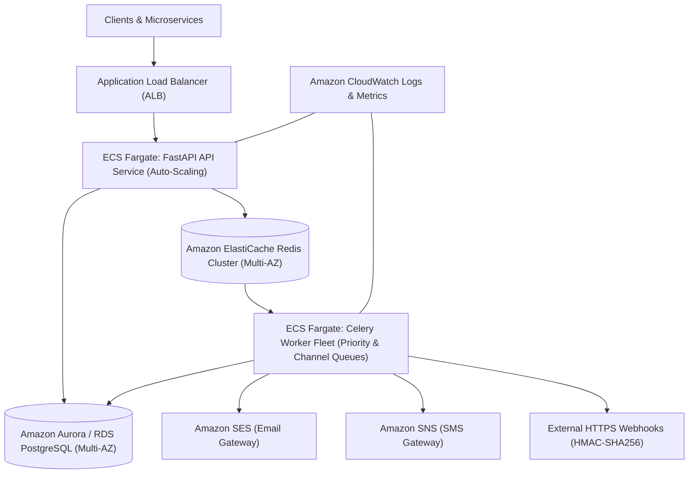

# AWS Production Deployment Guide

This guide outlines the production deployment architecture and steps for running the **Distributed Notification Platform** on Amazon Web Services (AWS).

---

## 1. High-Level AWS Architecture



---

## 2. Infrastructure Components

| Component | AWS Service | Purpose |
| :--- | :--- | :--- |
| **API Ingestion Layer** | AWS ECS Fargate | Serverless container execution for FastAPI with auto-scaling based on CPU/Request count. |
| **Worker Processing Layer** | AWS ECS Fargate | Dedicated task definitions for `high_priority`, `default_priority`, and `dlq` queues. |
| **Message Broker & Cache** | Amazon ElastiCache for Redis | High-throughput in-memory broker, sliding-window rate limiter, and idempotency locking. |
| **Relational Storage** | Amazon Aurora PostgreSQL | ACID-compliant storage for notification audit logs, templates, and delivery records. |
| **Email Gateway** | Amazon SES (Simple Email Service) | DKIM/SPF verified transactional email sending with bounce/complaint handling. |
| **SMS Gateway** | Amazon SNS (Simple Notification Service) | Direct carrier SMS delivery with international E.164 routing. |
| **Secrets Management** | AWS Secrets Manager | Secure storage of DB credentials, HMAC keys, and Redis connection strings. |

---

## 3. Step-by-Step Deployment

### Step 1: Build & Push Docker Images to ECR
```bash
# Authenticate Docker with AWS ECR
aws ecr get-login-password --region us-east-1 | docker login --username AWS --password-stdin <aws_account_id>.dkr.ecr.us-east-1.amazonaws.com

# Create Repository
aws ecr create-repository --repository-name notification-platform

# Build & Tag
docker build -t notification-platform:latest .
docker tag notification-platform:latest <aws_account_id>.dkr.ecr.us-east-1.amazonaws.com/notification-platform:latest

# Push Image
docker push <aws_account_id>.dkr.ecr.us-east-1.amazonaws.com/notification-platform:latest
```

### Step 2: Provision Infrastructure with CloudFormation
```bash
aws cloudformation create-stack \
  --stack-name distributed-notification-platform \
  --template-body file://aws/cloudformation-template.yml \
  --capabilities CAPABILITY_NAMED_IAM \
  --parameters ParameterKey=EnvironmentName,ParameterValue=production
```

### Step 3: Register ECS Task Definition & Deploy Service
```bash
# Register Task Definition
aws ecs register-task-definition --cli-input-json file://aws/ecs-task-definition.json

# Update ECS Service
aws ecs update-service --cluster production-notification-cluster --service notification-api-service --force-new-deployment
```
